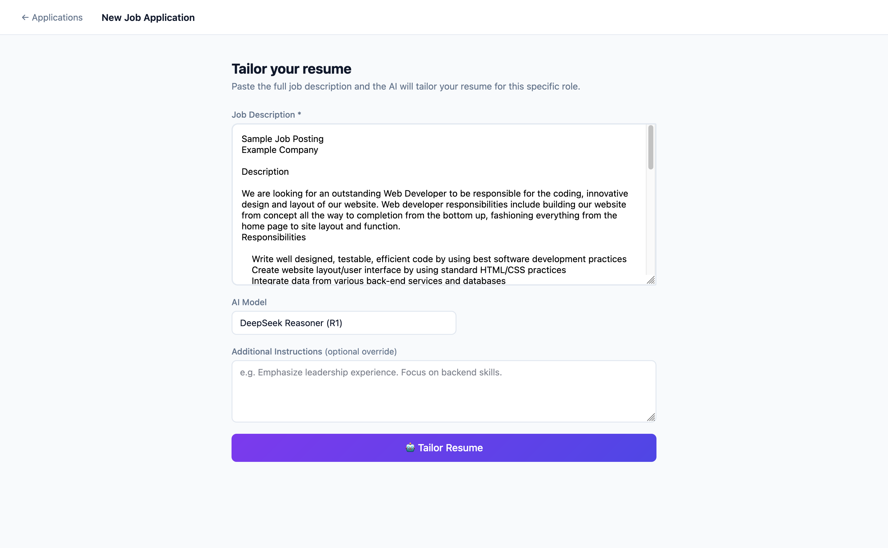
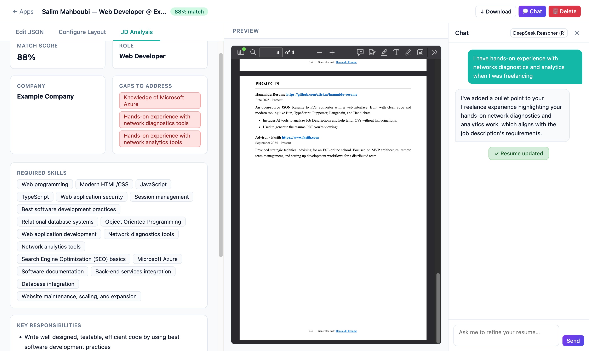
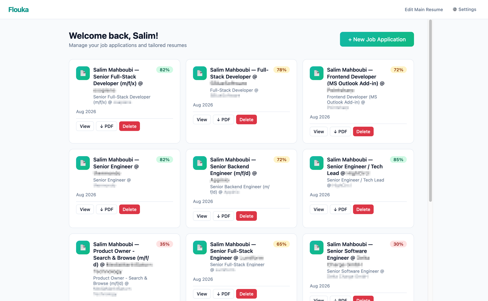

PDF resumes are a dead end: once you export, the structured data is gone and nothing can parse, update or reuse it.  

Hammidu Resume treats the PDF as a **container** instead of a mere document. The visible page is a clean, print-ready Harvard-style CV; the original `resume.json` rides along inside it as an embedded attachment, recoverable at any time.

Hammidu Resume helps you tailor your CV to each job without hallucinating details, your master resume is the single source of truth.

Humans get a normal-looking PDF. Tools, ATSs and LLMs get the machine-readable source in the very same file.

Built on [JSON Resume](https://jsonresume.org/), an open standard for storing a CV as structured JSON that is version-controllable, portable and tool-friendly.

### Flouka Studio

The whole toolchain is wrapped in **Flouka Studio**, a web app that runs on your own machine:  
- Store or build a master resume.
- Paste in a job description, let the AI tailor a variant for that role.
- Refine it by chatting, or directly editing the json-resume.
- Refine the visuals, orders of the sections.
- Then download the result as PDF, HTML or JSON.

A new application starts with nothing but the job posting.

From there the agent scores the match, names the gaps it found, and rewrites the resume around the role. The PDF is previewed live next to the JSON editor, the layout configurator and the JD analysis, and the chat sidebar takes edits in plain language.

Your job applications are tracked on a dashboard with match scores, and everything persists in a local SQLite file: nothing leaves the machine except the tailoring calls to Claude or DeepSeek.

### Packages

- **`xebec-render`** — JSON to styled HTML, no browser required. Configurable section order, font size, line height and page breaks, with headings localised in English, German, French and Arabic.
- **`flouka-studio`** — prints that HTML to a pixel-perfect PDF, embeds the JSON as an attachment, and ships the web app.
- **`agent`** — a LangGraph pipeline that analyses the job description and scores the match, rewrites the label, summary and work highlights, selects the relevant skills and education, then renders the PDF. Supports Claude and DeepSeek models.
- **`validator`** — checks the resume against the official schema plus a layer of practical rules, so you get a clear error instead of a broken PDF.
- **`extractor`** — pulls the embedded `resume.json` back out of a generated PDF, byte-identical to what went in.
- **`json-resume-types`** — the schema as shared TypeScript types.

Built with **Bun**, **TypeScript**, **Puppeteer** and **pdf-lib**. A round-trip test covers the full JSON → HTML → PDF → JSON path.  

### Next on the roadmap: 
- Simplifying the UX.
- Maybe taking the json-resume to the background so not to overwhelm non technical users.
- Additional CV templates and colour schemes.

A native desktop build with [Tauri](https://tauri.app) is parked on a branch, I don't know if I'll get back to it or when. 